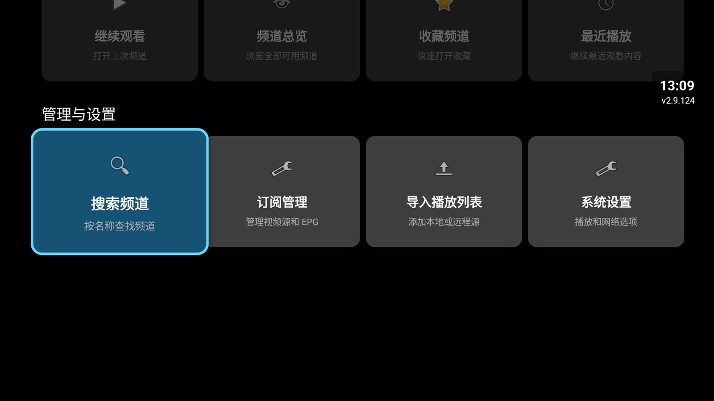
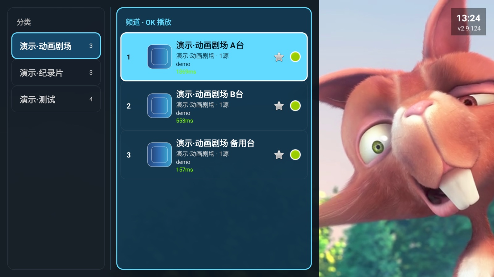
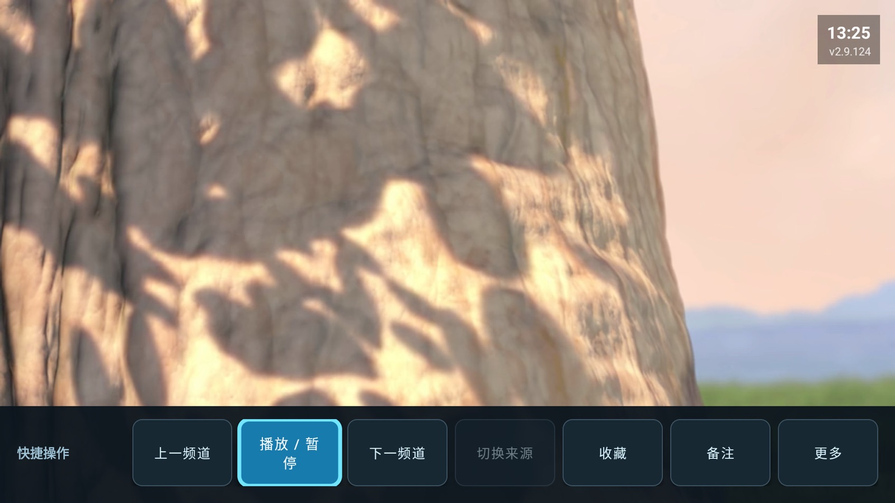
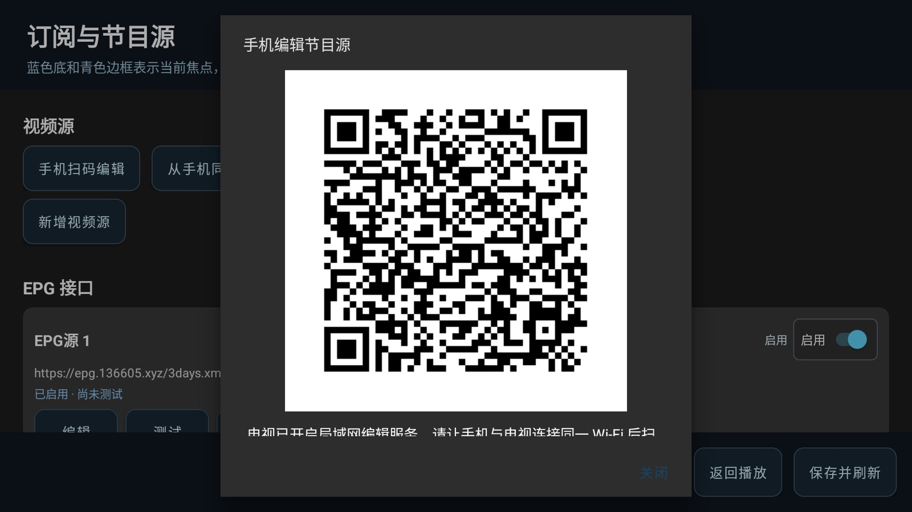
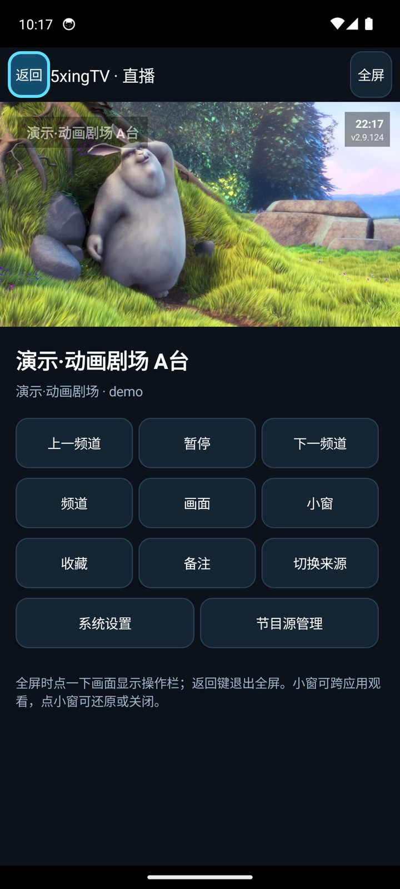
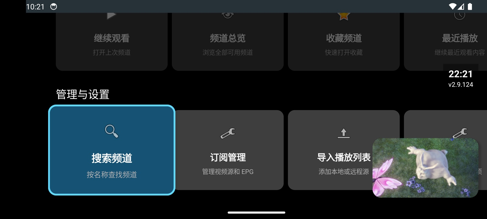

<div align="center">


# 5xingTV (AndroidTVIptvPlayer)

**A high-performance, ad-free IPTV player for low-spec devices**

A local player that ships with zero built-in channels, deeply optimized for aging TVs, TV boxes and old phones. Free, no ads, distributed under Apache-2.0.

[简体中文](README.md) | `English`

[](https://github.com/marui9819/AndroidTVIptvPlayer/actions/workflows/build-apk.yml)
[](LICENSE)

[⬇ Download APK 2.9.124](https://github.com/marui9819/AndroidTVIptvPlayer/releases/download/v2.9.124/5xingTV-v2.9.124-debug.apk) · [All releases](https://github.com/marui9819/AndroidTVIptvPlayer/releases) · [Wiki](https://github.com/marui9819/AndroidTVIptvPlayer/wiki) · [Product page](https://marui9819.github.io/AndroidTVIptvPlayer/)

If this player helps you, please tap **Star** ⭐ — device compatibility reports, issues and suggestions are welcome via [Issues](https://github.com/marui9819/AndroidTVIptvPlayer/issues).

</div>

---

## The problem it solves

That old TV in the living room, the set-top box gathering dust, the phone lying in a drawer — the hardware still works, but an ad-stuffed "smart" system makes everything sluggish. **5xingTV gives these devices a second life**: install it, navigate your own playlists smoothly with just the remote, and enjoy playback with no splash ads, no pause ads, no ads at all.

Set it up once for your parents: all they need is Up/Down to change channels and OK to open the channel drawer.

> ⚠️ This app is an "empty" player: it **contains no built-in channels, streams or programme content**. Add only sources you are authorized to use. Channels in the demo screenshots are public test streams named "演示·xxx" (Demo·xxx).

## Key features

| Feature | Details |
| --- | --- |
| 🖥 **Deep optimization for legacy devices** | Tuned buffering, decoding and background load for Android 6/7 and MStar 6A938-class hardware; the player runs in an isolated process so a codec crash never takes down the app |
| 🎮 **Complete remote-first TV operation** | D-pad navigation, channel drawer, quick-action dock, high-contrast focus enhanced for TV viewing distance — touch never required |
| 📱 **Phone picture-in-picture** | On Android 8+ the PiP window carries play/pause buttons; badges rescale with the window |
| 🔗 **Scan a QR code to manage sources from your phone** | The TV shows a QR code; edit sources in your phone's browser and sync back — **no computer needed** |
| 🔀 **Same-name channel merging** | Left/Right switches between alternate sources; auto-failover on playback errors (off by default, user-controlled) |
| ⏲ **Sleep timer & channel tools** | One-shot countdown that stops only the app (never powers off the TV); URL-bound channel notes, favorites, recent playback |
| 🔒 **Local-first privacy** | All data stays on the device; diagnostic reporting endpoint is unset by default; 160 unit tests |
| 🆓 **Free, ad-free, open source** | Distributed under Apache-2.0 |

<table>
<tr>
<td align="center"></td>
<td align="center"></td>
</tr>
<tr>
<td align="center">Home feature matrix</td>
<td align="center">Channel drawer: groups + list</td>
</tr>
<tr>
<td align="center"></td>
<td align="center"></td>
</tr>
<tr>
<td align="center">Remote quick-action dock</td>
<td align="center">Scan to manage sources from a phone</td>
</tr>
<tr>
<td align="center"></td>
<td align="center"></td>
</tr>
<tr>
<td align="center">Phone portrait player</td>
<td align="center">Phone picture-in-picture</td>
</tr>
</table>

## Legacy device support

Stutter on low-end hardware is usually not about raw power — it's EPG parsing, logo downloads and probes fighting the player for scarce CPU and RAM. 5xingTV targets Android 6/7 and MStar (e.g. 6A938) platforms specifically:

- **Isolated player process**: vendor MediaCodec/OMX glitches stay contained;
- **Curbed background load on legacy profiles**: EPG, logos and batch probing yield to playback;
- **Tiered playback buffers**: tuned to older TVs' memory constraints;
- **Straight to content**: home matrix + "continue watching" is one remote press away.

This is a best-effort optimization for the platforms above, not a compatibility guarantee for every legacy model. Decoding capability ultimately depends on firmware and the stream itself.

## Download & install

- Current build: [5xingTV 2.9.124 Debug APK](https://github.com/marui9819/AndroidTVIptvPlayer/releases/download/v2.9.124/5xingTV-v2.9.124-debug.apk)
- [All releases](https://github.com/marui9819/AndroidTVIptvPlayer/releases) · [Build workflow](https://github.com/marui9819/AndroidTVIptvPlayer/actions/workflows/build-apk.yml) · [Wiki](https://github.com/marui9819/AndroidTVIptvPlayer/wiki)

This is a debug sideload package, not a Google Play production-signed build. Install via USB drive, file manager or `adb install -r`, allowing "unknown sources" when prompted. If Android reports a signature conflict, uninstall the differently signed package first. Minimum Android 5.0/API 21; phone PiP requires Android 8.0/API 26 and system support.

## Quick start: remote basics

1. Open the app, go to **Subscription Management** or **Import Playlist**, and add an M3U/M3U8 URL you are authorized to use;
2. Four keys are all you need:

| Key | Action |
| --- | --- |
| Up / Down | Previous / next channel |
| OK | Open the channel drawer (groups + list) |
| Left / Right | Switch alternate sources of a merged channel |
| Menu / Back | Quick-action dock (favorites, notes, source switch, sleep timer…) |

3. Inside the channel list, use the D-pad to pick a channel; Right exposes favorites/notes/retry actions where applicable. Remote mappings may vary slightly across TV vendors.

## First use & content sources

The source and APK **contain no playlists, channel URLs, stream segments or directly watchable programme content**. After installing, add your own authorized sources via "Subscription Management" or "Import Playlist". Do not commit unauthorized sources, EPG or logos to this repository.

When looking for sources, prefer broadcasters, operators or content owners — official sites, licensed apps, publicly declared free streams, or subscriptions you may legally use. GitHub searches for `M3U`, `HLS`, channel names or regions can surface technical examples; read each repository's notes and license, and verify rights and local regulations case by case. Public availability does not grant redistribution rights; respect terms of service, do not scrape or spread unauthorized content, and remove temporary test sources when finished.

- Channel logos: prefer official broadcaster media kits; [Wikimedia Commons](https://commons.wikimedia.org/) is an option when the individual file page grants reuse — check attribution, license and trademark terms.
- EPG: prefer official schedules or licensed EPG services. [iptv-org/epg](https://github.com/iptv-org/epg) is a reference for EPG/XMLTV tooling and data formats, not a blanket endorsement; verify the license of any data you use.
- See the [XMLTV format reference](https://wiki.xmltv.org/index.php/XMLTVFormat).

### Community playlist projects

> **Disclaimer: these are third-party community projects, linked for reference only, and are unrelated to this project. Verify authorization and compliance before use; this project takes no responsibility for their content, availability or legality.**

| Project | Notes |
| --- | --- |
| [iptv-org/iptv](https://github.com/iptv-org/iptv) | Large global collection of publicly available channels, sorted by country/region/language |
| [vbskycn/iptv](https://github.com/vbskycn/iptv) | Daily-updated Chinese sources, dual-stack IPv4/IPv6 |
| [YanG-1989/m3u](https://github.com/YanG-1989/m3u) | Actively maintained aggregated playlist repository |
| [Guovin/iptv-api](https://github.com/Guovin/iptv-api) | Self-hosted tool that collects, tests and republishes playlists |

## Roadmap

The following are **planned / in development** — feedback welcome in Issues:

- [ ] Enhanced EPG management (visual editing, flexible refresh)
- [ ] Pinch-to-zoom gestures (currently three aspect-ratio presets)
- [ ] Tablet and large-screen layout polish
- [ ] Custom ordering of channel groups

## Redistribution & license

The player source is distributed under **[Apache-2.0](LICENSE)**. When redistributing or deriving, keep the [NOTICE](NOTICE) file and attribute the origin; mark any modifications clearly. **When reposting promotional material, never claim "built-in channels" or promise channel availability.** Third-party media, sites, logos and EPG remain with their respective owners.

## Build

Requires JDK 17 and Android SDK Platform 34; the Gradle Wrapper is included.

```bash
git clone https://github.com/marui9819/AndroidTVIptvPlayer.git
cd AndroidTVIptvPlayer
./gradlew testDebugUnitTest   # 160 unit tests
./gradlew assembleDebug       # output: app/build/outputs/apk/debug/app-debug.apk
```

The player uses ExoPlayer 2.18.7 / Android MediaCodec and does not run its own video relay or transcoding server. On Windows use `gradlew.bat`.

## Privacy

- Channels, favorites, notes and history stay on the device;
- Diagnostic reporting is unset by default and only activates if you configure an endpoint;
- The QR feature manages playlists on the local network only; the local debug log is viewable within the same network with limited capacity — do not share logs, QR codes or stream URLs publicly.

## Legal use

This repository and APK contain no live playlists, channel URLs, stream segments or directly watchable content. Add only sources you own, are licensed for, or that local law permits, and verify terms of service and copyright. Do not upload unauthorized sources to this repository or forward them to others; remove temporary test sources and related local data promptly after testing.

Playback quality on low-end devices, phones and OS versions varies with sources, platform APIs, network conditions and device decoders. Huya/Douyu adapters may break as their APIs change; this project does not promise that every channel works on every device, and is not responsible for user-supplied third-party content.

## Star the project

If 5xingTV is useful to you, please **Star** ⭐ it. Device compatibility reports and source-neutral bug reports are welcome through [Issues](https://github.com/marui9819/AndroidTVIptvPlayer/issues). Do not post private playlists, stream URLs, tokens, or logs containing viewing information.

## Related project

For LeTV Smart Home Center (屏霸) SHC Air owners, see the separate [LetvOfflineRemoteKey](https://github.com/marui9819/LetvOfflineRemoteKey) utility for configuring the remote's TV power-key IR profile. It is independent of this player.

---

**中文用户：** 完整中文文档见 [README.md](README.md)。

📱 Product page: [https://marui9819.github.io/AndroidTVIptvPlayer/](https://marui9819.github.io/AndroidTVIptvPlayer/)
